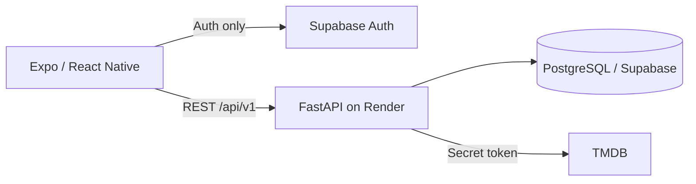

# Movie Tracker

Movie Tracker is a cross-platform iOS and Android application for discovering movies and
maintaining a personal watchlist and viewing history. It is not a streaming service.

Phase 1 supplies a working Expo/FastAPI/PostgreSQL foundation. Authentication, TMDB data,
search, libraries, people, and statistics intentionally follow in verified phases.

## Architecture



The mobile app never calls TMDB and never receives backend secrets. See
[`docs/architecture.md`](docs/architecture.md) for component responsibilities.

## Repository layout

```text
apps/mobile/             Expo Router TypeScript app
services/api/            Async FastAPI service and tests
supabase/                Supabase-specific policy/seed location
docs/                    Architecture, database, API, deployment, security
.github/workflows/       Backend and mobile CI
docker-compose.yml       Local API + PostgreSQL
render.yaml              Render Blueprint
```

## Prerequisites

- Git
- Docker Desktop (recommended for the API/database)
- Python 3.12 for running the API outside Docker
- Node.js 22.13 or newer and npm
- Expo Go on an Android/iPhone, or Android Studio for an emulator

## Quick start: backend with Docker

```powershell
cd movie-tracker
Copy-Item .env.example .env
docker compose up --build
```

Open `http://localhost:8000/health`, `http://localhost:8000/health/ready`, and
`http://localhost:8000/docs`. Stop with `docker compose down`; add `-v` only when you
explicitly intend to erase the local database volume.

## Quick start: backend without Docker

Start PostgreSQL first, then:

```powershell
cd movie-tracker\services\api
py -3.12 -m venv .venv
.\.venv\Scripts\Activate.ps1
python -m pip install -e ".[dev]"
Copy-Item .env.example .env
alembic upgrade head
uvicorn app.main:app --reload
```

## Quick start: mobile

```powershell
cd movie-tracker
npm install
Copy-Item apps\mobile\.env.example apps\mobile\.env
npm run mobile:start
```

For an Android emulator press `a` in Expo. For a physical phone, set
`EXPO_PUBLIC_API_BASE_URL` to the computer's LAN IP rather than `localhost`. Windows users
can test on iPhone with Expo Go or an EAS development build. EAS cloud builds produce iOS
artifacts; the iOS Simulator itself requires macOS.

## Environment variables

Phase 1 requires only `DATABASE_URL`, `CORS_ALLOWED_ORIGINS`, `ENVIRONMENT`, and `LOG_LEVEL`
for the backend. The mobile app uses `EXPO_PUBLIC_API_BASE_URL`. Supabase and TMDB entries are
present in templates but remain empty until their implementation phases. Never expose
`DATABASE_URL`, `TMDB_API_TOKEN`, `SUPABASE_JWT_SECRET`, or
`SUPABASE_SERVICE_ROLE_KEY` through an `EXPO_PUBLIC_*` name.

## Migrations

Alembic is the only application schema source of truth:

```powershell
cd services\api
alembic current
alembic upgrade head
```

Review generated SQL before applying migrations to hosted environments. Deployment never
automatically performs destructive migrations.

## Checks

```powershell
cd services\api
pytest
ruff check .
ruff format --check .
mypy app

cd ..\..
npm run mobile:test
npm run mobile:lint
npm run mobile:format
npm run mobile:typecheck
docker compose build
```

## Supabase setup roadmap

1. Create a Supabase project and record its URL and anon key.
2. Copy its PostgreSQL connection string into the backend environment only.
3. Prefer the Supabase pooler where it fits Render's connection model; confirm pool mode and
   async driver compatibility.
4. Apply reviewed Alembic migrations, then Phase 2 RLS policies.
5. Enable email/password authentication and configure `movietracker://` redirect URLs.
6. Put the anon key in mobile configuration; never put the service-role key there.

The complete authentication and RLS walkthrough is delivered with Phase 2 so its commands
match the implemented schema and policies.

## Render and EAS

Render deployment uses the root `render.yaml`; see [`docs/deployment.md`](docs/deployment.md).
EAS profiles for development, preview, and production are in `apps/mobile/eas.json`. Replace
the example application identifiers and supply original branding assets before distribution.

## Troubleshooting

- `npm.ps1 cannot be loaded`: use `npm.cmd`/`npx.cmd` or adjust the signed-script policy with
  your administrator.
- Phone cannot reach API: use the development computer's LAN IP and allow port 8000 through
  Windows Firewall.
- Readiness returns 503: verify PostgreSQL is healthy and that `DATABASE_URL` uses
  `postgresql+asyncpg://`.
- Port 5432 is occupied: change the host-side port in Compose or stop the other PostgreSQL.
- Expo dependency warning: run `npx expo install --fix` and commit the resulting lockfile.

## Attribution and security

Before TMDB functionality ships, the About screen will state: “This product uses the TMDB
API but is not endorsed or certified by TMDB.” TMDB branding assets will be linked to their
official source/license rather than copied without documentation. See
[`docs/security.md`](docs/security.md) for the security boundary.
