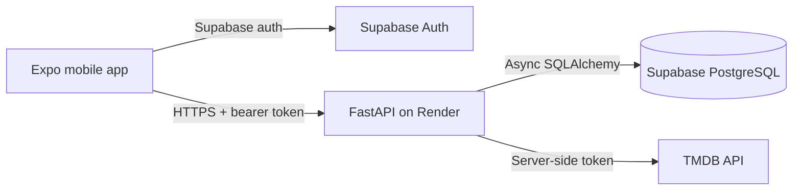

# Architecture

The mobile client is a shared iOS/Android Expo codebase. It may use Supabase directly only
for authentication. All movie metadata and user-library business operations cross the
versioned FastAPI boundary. The backend owns TMDB secrets, validates identity, applies
business rules, and maintains the PostgreSQL cache.

Phase 1 establishes process boundaries, configuration, health checks, and build tooling.
Domain models and external integrations are added incrementally in later phases.
